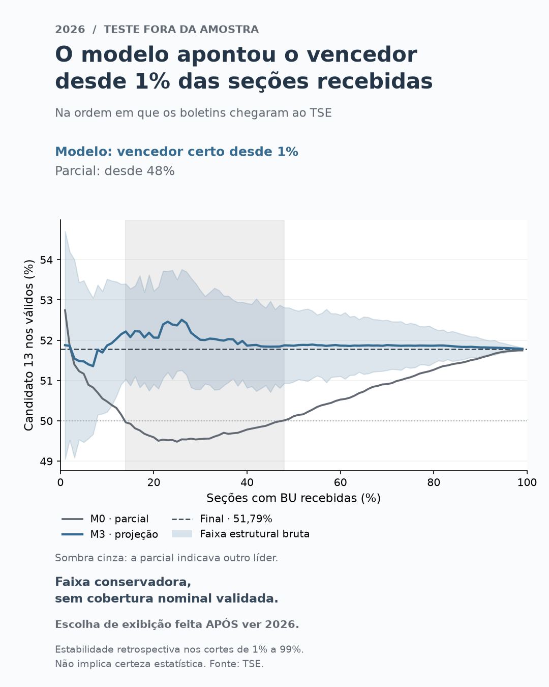

# eleicoes-apuracao

**Com 1% das seções recebidas, o modelo já apontava o vencedor e manteve o
mesmo líder nos demais cortes avaliados.**

## Pergunta

Quem ganha com 30% das urnas apuradas?

O projeto reproduz a sequência de recebimento dos boletins e compara a
parcial com projeções baseadas na eleição anterior. 2022 é o ano de
desenvolvimento/calibração; 2026 é o teste fora da amostra.

## Dados

Boletins de urna oficiais do TSE de 2018, 2022 e 2026 e indicadores municipais do IBGE.
URLs, colunas reais e limites das fontes estão em [docs/METODO.md](docs/METODO.md)
e [docs/FONTES_IBGE.md](docs/FONTES_IBGE.md).

## Método

O candidato 13 é A nos três anos; B é o candidato 17 em 2018 e o candidato 22
em 2022/2026. A notação serve para comparar proporções e swings. Textos e
gráficos usam números ou nomes de forma neutra, sem cores partidárias carregadas.

**2022 é desenvolvimento/calibração:** k e os fatores dos intervalos são
escolhidos nesse ano. **2026 é teste fora da amostra:** aplica-se a mesma
configuração, sem reajustar pelo resultado do teste. A sequência usada é a
ordem em que os boletins chegaram ao TSE.

Os horários de recebimento de 2022 e 2026 coincidem integralmente com o campo
Hora TSE do detalhe oficial por seção. O método os interpreta como Brasília,
com apoio nas normas eleitorais e na comparação entre UFs; não aplica ajustes
por UF. Há muitos boletins empatados no mesmo segundo, portanto a sequência
de recebimento não determina a ordem dentro desses grupos nem o instante de
divulgação pública. Veja as evidências e limites em [METODO.md](docs/METODO.md).

## Resultados

Na ordem em que os boletins chegaram ao TSE, o M3 apontou o candidato 13 como
vencedor desde 1% das seções nos dois anos e manteve esse líder nos demais
cortes de 1% a 99%. Essa estabilidade é retrospectiva e não significa
certeza estatística disponível naquele instante.

| Ano | Erro absoluto do M0 em 30% | Erro do M3 em 30% | M0: vencedor correto estável desde | M3: desde |
| --- | ---: | ---: | ---: | ---: |
| 2022 (desenvolvimento/calibração) | 1,9563 p.p. | +0,1947 p.p. | 68% | 1% |
| 2026 (teste fora da amostra) | 2,2354 p.p. | +0,2261 p.p. | 48% | 1% |



**A falha do intervalo faz parte do resultado.** O intervalo calibrado do M3
cobriu o resultado final em apenas **6,06% dos cortes de 2026**, apesar dos
90,91% em 2022, ajustados por construção. Os fatores do M3 eram de 0,031 a
0,076, não um fator uniforme de 0,22. Uma única eleição de calibração e seus
99 cortes autocorrelacionados não validam a transferência para outra eleição.
Nenhum fator nem previsão foi retocado olhando 2026.

Os gráficos usam a **faixa estrutural bruta: faixa conservadora, sem cobertura
nominal validada**. Ela cobriu 100% dos cortes desses dois anos. **A escolha
de exibi-la foi feita APÓS ver 2026** e não constitui uma validação fora da
amostra dessa escolha. A avaliação original e os intervalos calibrados estão
preservados em [RESULTADOS.md](docs/RESULTADOS.md).

O diagnóstico em 30% atribui ao swing/participação prevista contribuições de
+0,1941 p.p. em 2022 e +0,2399 p.p. em 2026. Comparecimento compensa parte do
erro de 2026; brancos/nulos e exterior têm efeitos pequenos. São substituições
oraculares para explicar o erro, sem ajustar o modelo ou demonstrar sua causa.

Outras figuras: [2022](reports/figures/projecao_2022.png),
[erros dos quatro modelos](reports/figures/erro_modelos.png) e
[swing municipal](reports/figures/swing_municipios_2022_2026.png).
O [notebook executado](notebooks/02_resultados.ipynb) reproduz as figuras e
exibe a decomposição do erro. O mapa é descritivo, usa resultados completos e
não entra nas features de previsão.

**Validação dos dados:** diferença zero contra fontes independentes do TSE
para votos por candidato, válidos, brancos, nulos, comparecimento e aptos.

| Ano | Seções no Parquet | Com BU, para simulação | Sem BU, para conciliar aptos |
| --- | ---: | ---: | ---: |
| 2018 | 454.490 | 454.448 | 42 |
| 2022 | 472.075 | 472.028 | 47 |
| 2026 | 499.248 | 499.205 | 43 |

As linhas sem BU são oficiais, têm votos e comparecimento zero e ficam fora
da simulação. Seção + local cobrem 98,9102% dos aptos de 2022 e 97,6169% dos
de 2026 no pareamento histórico. Os testes zeram e removem os resultados
das faltantes para impedir seu uso pelos modelos. Fontes e regras estão em
[METODO.md](docs/METODO.md).

## Como rodar

Com Python 3.12 e uv instalados, na raiz do projeto:

```powershell
uv sync
uv run python -m apuracao.download --ano 2026
uv run python -m apuracao.download --ano 2022
uv run python -m apuracao.download --ano 2018
uv run python -m apuracao.ingest
uv run python -m apuracao.match
uv run python -m apuracao.simulate
uv run python -m apuracao.features
uv run python -m apuracao.models --calibrar-k
uv run python -m apuracao.evaluate --workers 4 --n-jobs 1
uv run python -m apuracao.bias
uv run python -m apuracao.plots
uv run pytest
```

Cada chamada baixa o último turno publicado do ano escolhido, incluindo exterior,
e as fontes do IBGE. As pastas `data/raw`, `data/interim` e `data/processed` são
criadas automaticamente. O cache evita novos downloads de arquivos existentes;
os ZIPs são mantidos compactados e conferidos com SHA-512 oficial do TSE.
O catálogo também é armazenado em cache: as URLs usadas ficam nos manifestos.
Uma falha HTTP, de JSON ou de integridade interrompe a execução para inspeção.

Os dados ficam fora do Git. A ingestão baixa também as fontes oficiais de
conferência e gera `data/interim/secoes_{ano}.parquet`. Para um único ano,
use `uv run python -m apuracao.ingest --ano 2026`. O DuckDB instala a extensão
oficial `encodings` no primeiro uso e a reutiliza do cache. Evidências de
validação ficam versionadas em [VALIDACAO_INGESTAO.json](docs/VALIDACAO_INGESTAO.json).
